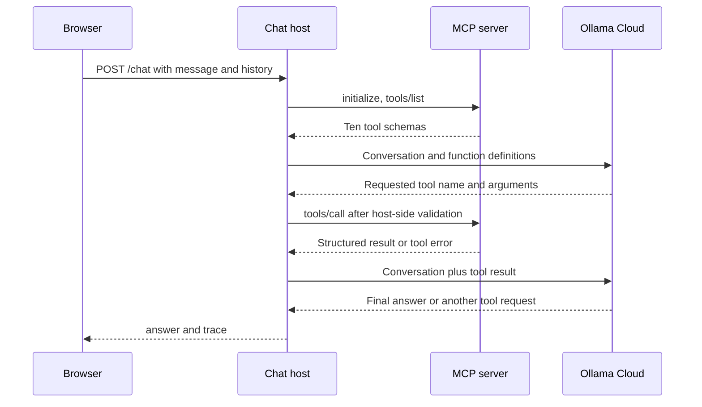

# Chat tutorial: let a model request MCP tools

[Project setup](../README.md#2-install-the-prerequisites) · [Previous: MCP server](../MCP_server/README.md) · [Next: Dashboard](../AI_dashboard_generation/README.md)

This app is an MCP **host**: it accepts a user message, discovers the server's tools, gives their schemas to Ollama, executes model-requested calls through an MCP client, and displays an answer and trace. The model chooses tool requests; the host actually executes them.

## 1. Start the dependencies and app

Complete the root [setup](../README.md#3-configure-mongodb-and-ollama-cloud), including the Ollama Cloud API key. Start HRMS on 8001, Inventory on 8002, and MCP on 8003. MongoDB is reached through the business APIs, never directly by this app.

In a separate PowerShell terminal at the repository root:

```powershell
Set-Location C:\Salmon\Simplilearn\MCP
.venv\Scripts\python.exe -m uvicorn AI_chat_assistant.main:app --host 127.0.0.1 --port 8004
```

Open [chat](http://127.0.0.1:8004), or [API docs](http://127.0.0.1:8004/docs). Ctrl+C stops the app. `/health` confirms only that the chat app is serving; it does not connect to its dependencies.

The shared runtime reads these root `.env` variables:

| Variable | Purpose |
|---|---|
| `MCP_URL` | Streamable HTTP endpoint, default `http://127.0.0.1:8003/mcp` |
| `OLLAMA_HOST` | Native Ollama HTTP base URL, default `https://ollama.com` |
| `OLLAMA_MODEL` | Default `gpt-oss:120b` |
| `OLLAMA_API_KEY` | Required server-side Cloud credential |

The root `.env` overrides inherited values. Restart chat after editing it. No local Ollama installation or downloaded model is needed for the configured Cloud API.

## 2. Follow one conversation turn



The host repeats the model/tool cycle until it gets an answer or hits a limit. Calls are sequential and responses are non-streaming. Every user request opens an MCP session and discovers the current catalog; tool names are not hardcoded into a separate chat API mapping.

| File | What to read |
|---|---|
| [main.py](main.py) | FastAPI, route registration, static files and health |
| [routes/chat.py](routes/chat.py) | `GET /` and `POST /chat` |
| [schemas.py](schemas.py) | `HistoryMessage`, `ChatRequest`, and `ChatResponse` |
| [services/chat_service.py](services/chat_service.py) | `chat`: system instructions, model loop, tool calls and trace |
| [config.py](config.py) | UI directory and execution limits |
| [templates/index.html](templates/index.html) | Chat form and message area |
| [static/chat.js](static/chat.js) | Browser history, request handling and trace display |
| [shared ai_runtime.py](../ai_runtime.py) | `mcp_connection`, `ollama_tools`, `call_tool`, `ask_model`, and current date |

### See how an MCP schema becomes a model tool

In `ollama_tools`, the host maps a discovered tool's name and description into an Ollama function definition, and supplies `tool.input_schema` as its `parameters`. This is the bridge between model tool calling and MCP.

When a model requests a function, `call_tool` checks that its name was discovered, validates its arguments against that schema, then invokes `session.call_tool`. The MCP server performs its own validation and delegates to the business APIs. The model never receives database credentials or the Cloud API key from these definitions.

The host adds the result back to the conversation using Ollama's tool-message shape. This small source excerpt shows the important feedback step:

```python
messages.append(
    {"role": "tool", "tool_name": name, "content": json.dumps(data)}
)
```

Without returning results to the model, it would know what it requested but not what the tool actually found. See [Ollama's tool-calling guide](https://docs.ollama.com/capabilities/tool-calling) for the underlying message flow.

## 3. Exercise: query and inspect the trace

In the browser, start with read-only requests:

- "Show employee counts by department."
- "List employees who have laptops, including IDs, names and emails."
- "What items are assigned to EMP001?"

Open the **MCP trace** below each reply. Inspect each entry's `tool`, `arguments`, `is_error`, and `result`. A laptop-owner request can use `inventory_get_item_owners` to combine both domains. A more complex request can use multiple calls. The exact sequence and wording depend on the model; check the trace rather than assuming a specific tool was selected.

You can also make a read-only request from PowerShell:

```powershell
$chatBody = @{
    message = 'List laptop owners with their IDs, names and emails.'
    history = @()
} | ConvertTo-Json -Depth 6
$reply = Invoke-RestMethod -Method Post -Uri 'http://127.0.0.1:8004/chat' -ContentType 'application/json' -Body $chatBody -TimeoutSec 180
$reply.answer
$reply.trace | ConvertTo-Json -Depth 10
```

The request JSON is:

```json
{
  "message": "List laptop owners with their IDs, names and emails.",
  "history": []
}
```

The response has `answer` (text) and `trace` (a list). A successful business request should have useful data in the trace, not just plausible prose. Empty query results are valid.

### Conversation memory

Browser history lives in JavaScript memory and disappears on reload or **Clear conversation**. The browser submits up to the most recent 40 user/assistant messages with the next request. The server does not store chat sessions in MongoDB. Tool results are available within the current model loop but are not stored as browser history messages.

`ChatRequest` allows a 1–4000-character message and up to 40 history entries, each with role `user` or `assistant` and content up to 20,000 characters. Unknown request fields are rejected.

## 4. Understand writes and limits

Chat discovers all ten tools, including four writes. An explicit request such as "Change EMP900's department to Finance" can persist a change if that dummy employee exists. Before trying this, create the fictional record in the [HRMS write exercise](../HRMS/README.md#optional-write-exercise-create-and-update-a-fictional-employee). Verify the result with a read request.

The system prompt asks the model to clarify missing fields, resolve ambiguous names, avoid writes for read-only questions, and re-read after uncertain write errors. These are model instructions, not a separate authorization mechanism. Tool schemas and business API validation enforce input and state rules; production authentication is outside this project.

Current constants in [config.py](config.py) are **25 model rounds** and **20 tool calls per request**. A round is one request to the model, which may request several tools. Hitting a limit returns an explanatory answer and the accumulated trace. The date supplied to the prompt uses Asia/Kolkata.

If the model fails after tools ran, the service returns the trace with a message that requested changes may have completed. Neither the app nor the REST adapter automatically retries writes. Read the affected employee or item before retrying.

## 5. Verify and troubleshoot

Run offline host/transport tests from the root:

```powershell
.venv\Scripts\python.exe -m pytest -q tests/test_mcp_and_ai.py
```

These use mocked model responses and an in-memory business database. For explicit live Cloud tests with all apps running, see [root verification](../README.md#7-verify-and-troubleshoot). They consume model usage.

| Problem | What to check |
|---|---|
| MCP connection error | MCP must be running at `MCP_URL`, using `/mcp`. Check HRMS/Inventory if discovery works but calls fail. |
| Ollama Cloud request failed | Check root `.env`, key, host/model, network and account usage. Restart the AI process after configuration edits. |
| Tool result has an error | Inspect its code/message; do not treat an HTTP-successful chat response as proof a change succeeded. |
| Old tool catalog | Restart MCP after source changes. Chat itself discovers tools anew for each request. |
| Incomplete list or limit response | Narrow the request, use summary for employee counts, or ask for a specific page. |
| UI health succeeds but requests fail | `/health` does not test upstream dependencies. |

Continue with the [dashboard tutorial](../AI_dashboard_generation/README.md) to see the same MCP server used with a fixed retrieval flow.
