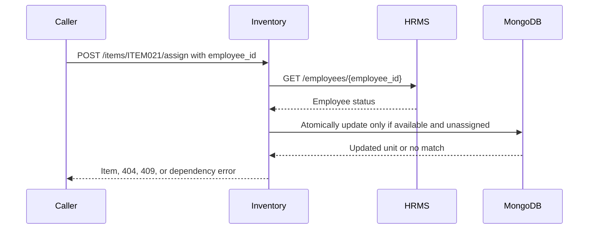

# Inventory tutorial: track items assigned to employees

[Project setup](../README.md#2-install-the-prerequisites) · [Previous: HRMS](../HRMS/README.md) · [Next: MCP](../MCP_server/README.md)

[Inventory UI guide](#streamlit-inventory-workspace) · [Tool-usage insights](../MCP_server/README.md#streamlit-tool-usage-insights) · [Git/local-file guide](../README.md#8-keep-local-files-out-of-git)

Inventory stores individual physical units: a laptop, mouse, T-shirt, or bottle. Every unit has its own ID, even when several units have the same type. The app exposes four REST operations and calls HRMS before assigning an item.

The API runs on **8002** and its optional Streamlit UI on **8502**. Direct UI/Swagger requests use REST and do not create MCP usage events. Inspect Inventory MCP calls in the separate usage workspace on **8505**; Inventory itself stores neither usage events nor user preferences.

## 1. Start the app

Complete the root [setup and seed instructions](../README.md#4-seed-and-start-the-apps). MongoDB is required at startup. HRMS must be running for new assignments; list/get/return do not call HRMS. Neither Ollama nor MCP is required for these REST exercises.

In a new PowerShell terminal at the repository root:

```powershell
Set-Location C:\Salmon\Simplilearn\MCP
.venv\Scripts\python.exe -m uvicorn Inventory_management.main:app --host 127.0.0.1 --port 8002
```

Open [Swagger](http://127.0.0.1:8002/docs). Use another terminal for requests. Ctrl+C stops the service.

[config.py](config.py) reads `MONGODB_URI`, `MONGODB_DATABASE` (default `mcp_learning`) and `HRMS_URL` (default `http://127.0.0.1:8001`) from the root configuration. It shares the cluster and database with HRMS but owns a different collection.

## Streamlit Inventory workspace

Install dependencies using the [shared setup](../README.md#2-install-the-prerequisites), then keep Inventory running on 8002. HRMS on 8001 is required for new assignments. MCP and Ollama are not needed by this UI.

In another PowerShell terminal at the repository root:

```powershell
.venv\Scripts\python.exe -m streamlit run Inventory_management/ui/main.py --server.address 127.0.0.1 --server.port 8502
```

Open [the Inventory workspace](http://127.0.0.1:8502). Stop it with Ctrl+C. `INVENTORY_URL` defaults to `http://127.0.0.1:8002`, loaded from the root `.env` with the same precedence as the other apps. The UI uses REST only; the existing backend owns database access and employee validation. The theme comes from the root `.streamlit/config.toml`.

- **Overview:** five count cards show total, available, assigned, maintenance and retired units. Two panels chart item types and categories. Every page is retrieved with `limit=100` before calculating counts; inconsistent or failed retrieval hides totals instead of presenting partial counts. Refresh reads fresh data.
- **Item directory:** apply category/status segmented controls and exact item-type/employee-ID filters. Choose 20, 50 or 100 rows, move between pages, and open a unit using its pinned ID, current-page selector or exact-ID lookup. Selection stores the item ID, not a row position.
- **Selected item:** review its status, owner and timestamps. Assign is available only for available items, Return only for assigned items. Maintenance and retired items expose no write controls. A return includes the employee ID shown in the form so the backend can reject a conflicting ownership change.

Start with a read-only exercise: open Overview, note the complete total, then filter the directory to assigned laptops. Open one unit and inspect its current employee ID. To try a **write**, choose an available unit, enter an existing joining/active employee ID and explicitly submit Assign item; this changes the dummy database. Return item clears the assignment. Ordinary widget reruns never repeat either operation.

The UI keeps entered IDs after validation/conflict errors. An uncertain network/write outcome blocks further changes to that unit. Click **Reload item**, inspect current ownership, and decide whether another submission is needed. Failed reloads do not remove the block. HTTP requests use a 30-second timeout and are not retried.

| Module | Responsibility |
|---|---|
| [ui/main.py](ui/main.py) | Page configuration, sidebar navigation and state initialization |
| [ui/app_pages/overview.py](ui/app_pages/overview.py) / [directory.py](ui/app_pages/directory.py) | Direct page scripts |
| [ui/components.py](ui/components.py) / [item_actions.py](ui/item_actions.py) | Native presentation and explicit assignment forms |
| [ui/state.py](ui/state.py) | Session defaults, stable selection and pagination callbacks |
| [ui/services/inventory_client.py](ui/services/inventory_client.py) | Typed REST requests, errors and complete pagination |

Run `.venv\Scripts\python.exe -m pytest -q tests/test_streamlit_workspaces.py` for offline UI checks using in-memory REST data and mocked HTTP. If the UI reports unavailable data, check Inventory on 8002 and its MongoDB connection. If assignment fails, check HRMS, the employee's status and current item availability. If 8502 is occupied, stop the previous UI instance; `run.py` does not manage Streamlit processes.

## 2. Follow an assignment request



| File | What to read |
|---|---|
| [main.py](main.py) | FastAPI lifespan, database indexes and error handling |
| [routes/items.py](routes/items.py) | The four REST routes and list parameters |
| [schemas.py](schemas.py) | `AssignmentRequest`, `Item`, `Assignment`, `ItemPage`, and enums |
| [services/inventory_service.py](services/inventory_service.py) | `list_items`, `validate_employee`, `assign_item`, `return_item`, and serialization |
| [database.py](database.py) | Collection connection and indexes |
| [config.py](config.py) | Database and HRMS settings |

## 3. Understand the inventory document

Inventory owns `mcp_learning.inventory_items`:

| Field | Meaning |
|---|---|
| `_id` | Unique string unit ID; serialized as `item_id` |
| `name` | Display name, e.g. `Dell Latitude Laptop` |
| `category` | `device` or `goody` |
| `item_type` | Type such as `laptop`, `mouse`, `tshirt`, or `bottle` |
| `status` | `available`, `assigned`, `maintenance`, or `retired` |
| `assignment` | Current `{employee_id, assigned_at}` or null |
| `created_at`, `updated_at` | UTC BSON datetimes |

An illustrative assignment as serialized in JSON:

```json
{"employee_id": "EMP001", "assigned_at": "2026-10-18T10:00:00Z"}
```

The ID identifies one physical unit; `item_type` groups similar units. Three T-shirts are three documents, not a stock quantity of three. The built-in `_id` index is unique; additional indexes cover `(category, status)` and `assignment.employee_id`.

An item can have only one current owner. Assignment history, stock quantities, new-unit creation and maintenance workflows are outside the four APIs; inventory units are inserted by the root seed script.

## 4. Try the APIs

| Method and path | Purpose | MCP tool |
|---|---|---|
| `GET /items` | Filter and paginate units | `inventory_list_items` |
| `GET /items/{item_id}` | Read one unit and current assignment | `inventory_get_item` |
| `POST /items/{item_id}/assign` | Assign an available unit | `inventory_assign_item` |
| `POST /items/{item_id}/return` | Return a unit from its expected owner | `inventory_return_item` |

### Read units and ownership

```powershell
Invoke-RestMethod -Uri 'http://127.0.0.1:8002/items/ITEM001' | ConvertTo-Json -Depth 6
Invoke-RestMethod -Uri 'http://127.0.0.1:8002/items?category=device&status=available&limit=5' | ConvertTo-Json -Depth 6
Invoke-RestMethod -Uri 'http://127.0.0.1:8002/items?employee_id=EMP001&limit=100' | ConvertTo-Json -Depth 6
```

These are read-only. Filters are exact matches on `category`, `item_type`, `status`, and current `employee_id`. Lists sort by item ID and return `{items, total, limit, offset, has_more}`. Default limit is 20, maximum 100; follow `has_more` with increasing offsets for complete lists. An empty list is valid.

### Optional write exercise: assign and return a unit

The next commands **temporarily change ownership of a currently available laptop**. They select an active employee and available unit from your current data rather than assuming a seeded item is still available. The return step clears the assignment again. Run the steps in the same PowerShell session.

```powershell
$available = Invoke-RestMethod -Uri 'http://127.0.0.1:8002/items?item_type=laptop&status=available&limit=1'
$active = Invoke-RestMethod -Uri 'http://127.0.0.1:8001/employees?status=active&limit=1'
if ($available.items.Count -eq 0 -or $active.items.Count -eq 0) {
    throw 'This exercise requires an available laptop and an active employee.'
}
$demoItemId = $available.items[0].item_id
$demoEmployeeId = $active.items[0].employee_id
$assignmentBody = @{ employee_id = $demoEmployeeId } | ConvertTo-Json

Invoke-RestMethod -Method Post -Uri "http://127.0.0.1:8002/items/$demoItemId/assign" -ContentType 'application/json' -Body $assignmentBody
Invoke-RestMethod -Uri "http://127.0.0.1:8002/items/$demoItemId" | ConvertTo-Json -Depth 6

Invoke-RestMethod -Method Post -Uri "http://127.0.0.1:8002/items/$demoItemId/return" -ContentType 'application/json' -Body $assignmentBody
```

After assignment, expect status `assigned` and an assignment with the selected employee and a timestamp. After return, expect status `available` and `assignment: null`. `updated_at` changes; the original creation timestamp remains.

Both writes take this REST body, with your selected ID substituted:

```json
{"employee_id": "EMP001"}
```

### Why the update is atomic

`assign_item` performs one MongoDB `find_one_and_update` with a predicate matching the ID, `status=available`, and `assignment=null`. It changes status and ownership together. Two competing assignments cannot both match the same available state. Return similarly requires the expected current employee ID before clearing ownership.

HRMS validation happens before the database operation and accepts only `joining` or `active` employees. This is not a cross-service transaction: an employee's status could change between validation and assignment. Inactivating an employee later preserves ownership so outstanding equipment remains visible. Returning their item does not require them to still be active.

## 5. Connect this to MCP

The separate [MCP owner lookup](../MCP_server/services/item_owner_service.py) can answer "who has laptops?" by reading assigned inventory units, collecting unique employee IDs, and asking HRMS for names and emails. This composite tool adds no fifth Inventory REST endpoint. The Inventory app still knows only employee IDs. MCP also owns usage events and preference tools separately; Inventory's four APIs remain unchanged.

## 6. Verify and troubleshoot

From the root, run offline API tests:

```powershell
.venv\Scripts\python.exe -m pytest -q tests/test_apis.py
```

For a live database check:

```powershell
Invoke-RestMethod -Uri 'http://127.0.0.1:8002/health'
```

| Result/problem | What it means |
|---|---|
| 404 | The item or employee does not exist. Confirm IDs and the configured database. |
| 409 on assign | The unit is unavailable, already assigned, or the employee is inactive. Re-read the records. |
| 409 on return | The unit is not assigned to that employee; use its current owner. |
| 422 | Check category/status enums, pagination, and employee-ID format. |
| 503 | MongoDB or HRMS is unavailable. `HRMS_URL` must match the running employee API. |
| Startup/port/import failure | Check MongoDB, port 8002, root working directory, and virtual environment. |

After an uncertain write timeout, query the unit before retrying. Continue with the [MCP tutorial](../MCP_server/README.md) to expose the APIs as discoverable tools.
