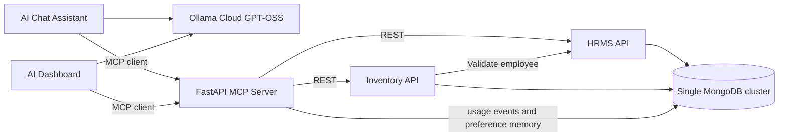

# MCP System Plan

## 1. Goal and architecture

Build five small FastAPI applications to learn MCP discovery, argument schemas, tool calls, structured results and reuse across two AI applications. Keep HTTP routes separate from business services.



| Application folder | Port | Responsibility |
|---|---:|---|
| HRMS | 8001 | Employee records and summaries |
| Inventory_management | 8002 | Inventory units and current assignments |
| MCP_server | 8003 | Thirteen typed MCP tools, business REST adapters and MongoDB operational storage |
| AI_chat_assistant | 8004 | Conversation and model-controlled tool loop |
| AI_dashboard_generation | 8005 | Validated layouts and Python-calculated dashboard values |

HRMS and Inventory own the business collections. MCP translates business tool calls into REST calls and directly owns only usage events and user preferences in MongoDB. It has no LLM integration. The official Python MCP SDK handles the protocol, mounted in FastAPI at `/mcp` using Streamable HTTP. The parent lifespan initializes MongoDB and starts the MCP session manager.

The AI applications are MCP hosts. Chat exposes discovered tool schemas to the model; the host executes its requested calls. The dashboard deterministically retrieves records through MCP and uses AI to select a display layout.

## 2. MongoDB structure

Use one cluster and one database, `mcp_learning`, with four collections:

```text
mcp_learning
├── employees
├── inventory_items
├── tool_usage_events
└── user_preferences
```

### employees — owned by HRMS

| Field | Type | Meaning |
|---|---|---|
| _id | string | Immutable ID, e.g. EMP001; API name employee_id |
| full_name | string | Fictional employee name |
| email | string | Unique, normalized lowercase |
| department | string | Engineering, Finance, People or Sales in seed data |
| designation | string | Job title |
| joining_date | ISO date string | YYYY-MM-DD |
| status | enum | joining / active / inactive |
| created_at, updated_at | BSON datetime | UTC timestamps |

Indexes: built-in unique `_id`; unique `email`; compound `(department, status, joining_date)`.

Employee IDs are supplied on creation. No payroll, salaries, leave or authentication records in v1.

### inventory_items — owned by Inventory

Every device and goody is an individual physical unit. Three T-shirts are three documents.

| Field | Type | Meaning |
|---|---|---|
| _id | string | Immutable unit ID, e.g. ITEM001; API name item_id |
| name | string | Display name |
| category | enum | device / goody |
| item_type | string | laptop / mouse / tshirt / bottle |
| status | enum | available / assigned / maintenance / retired |
| assignment | object or null | Current ownership only |
| created_at, updated_at | BSON datetime | UTC timestamps |

An assignment contains `employee_id` and `assigned_at` (BSON UTC datetime, serialized as ISO 8601).

Indexes: built-in unique `_id`; compound `(category, status)`; `assignment.employee_id`.

Rules:

- Assign only to an existing joining or active employee, validated through HRMS.
- Atomically assign only an available unit with no current owner.
- Atomically return only a unit assigned to the expected employee, clearing current ownership.
- Inactivating an employee preserves their existing assignments.
- MongoDB does not enforce employee references. Validation and assignment are separate service operations, not a cross-service transaction.
- Keep current ownership only. Assignment history and quantity-based stock are outside v1.

Seed 30 fictional employees and 60 inventory units with stable IDs, four departments, varied joining dates, all employment statuses and all item statuses. Use insert-only upserts so rerunning never overwrites demo changes. Seed inventory rather than adding a tenth API.

## 3. Nine business APIs and thirteen MCP tools

| # | Owner | REST endpoint | MCP tool |
|---|---|---|---|
| 1 | HRMS | POST /employees | hrms_create_employee |
| 2 | HRMS | GET /employees | hrms_list_employees |
| 3 | HRMS | GET /employees/summary | hrms_get_employee_summary |
| 4 | HRMS | GET /employees/{employee_id} | hrms_get_employee |
| 5 | HRMS | PATCH /employees/{employee_id} | hrms_update_employee |
| 6 | Inventory | GET /items | inventory_list_items |
| 7 | Inventory | GET /items/{item_id} | inventory_get_item |
| 8 | Inventory | POST /items/{item_id}/assign | inventory_assign_item |
| 9 | Inventory | POST /items/{item_id}/return | inventory_return_item |

The tenth tool, `inventory_get_item_owners`, composes the existing Inventory and HRMS REST APIs. It accepts exactly one of `item_type` or validated `item_id`, plus `limit=20` (maximum 100) and `offset=0`. Trim and lowercase item types. Read all matching assigned inventory pages at 100 units per page, deduplicate and sort owner IDs, paginate those owners, then fetch selected employees from HRMS. Return `{items, total, limit, offset, has_more}` with `employee_id`, `full_name`, and `email` only. Include inactive current owners. Unassigned units and unmatched types return empty lists; nonexistent item IDs and broken selected employee references return 404; invalid lookup combinations return 422. Dependency failures return tool errors rather than partial owner pages. No new REST endpoint or database collection is required.

Employee creation requires ID, full name, email, department, designation and joining date; status defaults to joining. Update accepts a nonempty subset of editable fields and cannot change ID or timestamps. The MCP update tool takes a `changes` object; the REST PATCH body contains those fields directly.

Employee list filters: literal case-insensitive name substring, exact department/status and inclusive joining_from/joining_to dates. Summary supports the same filters except name and returns total and counts by department, status and joining month. Declare `/employees/summary` before the dynamic employee route.

Item list filters: exact category, item_type, status and employee_id. Both assignment and return require item ID and employee ID. Single-record endpoints return the record or 404.

Shared conventions:

- Pydantic requests and responses; list ordering by ID.
- limit=20, maximum 100; offset=0.
- List envelope: `{items, total, limit, offset, has_more}`.
- Creation returns 201; successful reads and updates return 200.
- Errors: 404 missing, 409 duplicate/conflict, 422 invalid input, 503 unavailable dependency.
- No automatic write retries after uncertain outcomes; re-read the affected record first.
- Health, documentation and AI interface routes are outside the nine business APIs.

MCP tools have typed arguments and precise descriptions, structured results, and read/write annotations. Including memory, seven tools are read-only and six change state. Preserve upstream error codes/messages in MCP results marked `isError`. Use fixed upstream URLs. Do not expose generic HTTP, MongoDB query or Python execution tools. The SDK serves `tools/list` and `tools/call`.

### Operational storage and memory

MCP owns `tool_usage_events`: one metadata-only event per incoming `tools/call`, including invalid input, unknown tools, errors and cancellations. Store tool/user/source/request-group IDs, UTC timestamps, elapsed duration, outcome and available error code. Do not store arguments, results, prompts or transcripts. A TTL index on completion expires events after 90 days; compound tool/time and user/time indexes support aggregate queries. SDK middleware surrounds validation and execution. Runtime logging is bounded and best effort, preserving the original tool result without repeating writes.

`GET /usage/stats` is an operational REST endpoint, excluded from the nine business API count and MCP catalog. Optional tool/user/source and inclusive UTC date filters return overall/per-tool counts and mean duration. MongoDB is required at startup and checked by MCP health.

The standalone Streamlit usage workspace on port 8505 adds Overview, Tool performance and Call explorer pages. It reads `GET /usage/insights` for complete filtered aggregates and daily/hourly UTC trends, plus `GET /usage/events` for paginated metadata and unfiltered request-group chronology. Shared filters include tool, user, source, outcome, anonymous-only and inclusive UTC dates; insight views span at most 90 days. It uses manual refresh and session snapshots, no model or protocol calls, and does not create usage events. `MCP_API_URL` is the REST base without `/mcp`. The thirteen-tool catalog, event schema and retention are unchanged. See the MCP tutorial for startup and metric definitions.

`user_preferences` has one permanent profile per demo-user ID, with chat/dashboard key/value maps and UTC creation/update timestamps. Atomic updates preserve other keys. Three tools expose it: `memory_get_preferences` (read), `memory_set_preference(scope,key,value)` and `memory_delete_preference(scope,key)` (writes). Keys allow 1–64 letters/digits/underscores/hyphens; values are trimmed nonempty strings up to 1,000 characters. Missing profiles return empty maps; missing identity/invalid inputs return 422, storage errors 503. Identity comes from `X-Demo-User-ID`, never a model argument. These are local demo profiles, not authentication.

## 4. AI applications and module structure

### Ollama Cloud

Use `OLLAMA_HOST=https://ollama.com`, `OLLAMA_MODEL=gpt-oss:120b` and the existing `OLLAMA_API_KEY`. Connect directly with the native HTTP API; no local Ollama installation is needed. Secrets stay on the server.

On 17 October 2026, planning checks authenticated successfully, returned a valid fictional employee-search tool call and generated parseable dashboard layout JSON. These planning checks were not a full integration test.

Cloud schema-enforced structured output is not assumed. Prompt for JSON, validate locally and allow one repair attempt.

### Chat

Provide GET `/` and POST `/chat`. Keep browser-side conversation history and submit user/assistant history with each message.

Initialize an MCP session, discover tools, map schemas to Ollama function definitions, execute validated model-requested calls through MCP, append results and repeat. Use all thirteen tools. Execute business/preference writes only for explicit requests, clarify missing details, and resolve ambiguous names before changing records. Treat records and saved preferences as data, never instructions or authorization.

Limit each request to twenty-five model rounds and twenty tool calls. Identified requests load saved preferences through MCP first; this consumes one call and appears in the trace. Anonymous requests skip memory. Start non-streaming and execute calls sequentially. Return the answer and an expandable trace of tool names, arguments and outcomes.

Examples: joining employees this month; items assigned to EMP001; assign ITEM021 to EMP001; move EMP002 to Finance.

### Dashboard

Provide GET `/` and POST `/dashboards/generate`. Discover the same tools but allow only the seven read tools. Identified users load saved preferences first, using only the dashboard scope. Retrieve both complete lists through the two MCP list tools and join records by employee_id in Python. Paginate with a shared twenty-call budget, including the memory read; reject incomplete data before calculating totals. The model chooses layout, not data tools. Latest instructions and existing validation override saved defaults.

Ask AI for a DashboardSpec with title and widgets: card, bar or table; known dataset; exact-match filters; applicable group_by, metric or columns. Known datasets are employees, items and assigned_items. Only count aggregation is supported. assigned_items contains one row per item with owner details; item counts must not be presented as unique employee counts.

Validate fields against allowlists, compute every value in Python, and render with a fixed HTML/CSS/JavaScript page and Chart.js. Never run generated code or HTML. Permit one JSON repair, then return a clear error. Keep the result in browser memory. Regeneration fetches fresh data; persistence and automatic refresh are outside v1.

### Modules

Each app contains main.py, config.py, schemas.py, routes/ and services/. main.py wires FastAPI and lifespan; routes handle HTTP; services implement behavior. Add database.py to database apps, tools/ to MCP, and templates/static to AI apps.

Use ordinary functions and small modules. Avoid repositories, agent frameworks, queues and shared domain-service packages. Share only environment loading and AI transport plumbing. Use synchronous PyMongo and synchronous database API routes; asynchronous HTTP for MCP and AI interactions.

Load root .env without logging secrets, provide .env.example and ignore rules, and pin compatible requirements. Bind to 127.0.0.1. Production authentication and hosting are outside v1.

## 5. Delivery and validation

Implement in order: models/indexes/seed and REST APIs; MCP server and Inspector checks; chat loop and trace; dashboard retrieval/layout/rendering; documentation and startup commands.

Acceptance:

- Five HRMS and four Inventory business endpoints back ten business tools; three memory tools bring discovery to thirteen.
- Owner lookup supports type/ID inputs, unique employees, inventory and owner pagination, correct projected fields, and explicit errors for invalid input or failed dependencies.
- Duplicate IDs/emails, invalid references and unavailable items fail clearly.
- Competing assignments produce one success and one conflict.
- Wrong-owner returns fail; inactivation preserves current ownership.
- Explicit chat updates are visible in a subsequent read, and chat combines both domains through MCP.
- Dashboard totals use all fetched pages; dashboard cannot invoke write tools.
- Invalid arguments, malformed layouts, model failures and upstream outages are understandable.
- Pagination and empty datasets work correctly.
- Default tests use in-memory MongoDB and mocked model replies; real Cloud smoke checks are explicit.

The implementation includes rerunnable seed/start commands, offline tests with real MCP transport integration, and an opt-in live connectivity check. See README.md for commands and the exact tool interfaces.

### Primary references

- [MCP SDK and FastAPI mounting](https://py.sdk.modelcontextprotocol.io/run/asgi/)
- [MCP tools](https://modelcontextprotocol.io/specification/2025-11-25/server/tools)
- [MongoDB references](https://www.mongodb.com/docs/manual/data-modeling/referencing/)
- [MongoDB embedding](https://www.mongodb.com/docs/manual/data-modeling/embedding/)
- [Ollama Cloud GPT-OSS](https://ollama.com/library/gpt-oss%3A120b-cloud)
- [Ollama tool calling](https://docs.ollama.com/capabilities/tool-calling)
- [Ollama structured output limitations](https://docs.ollama.com/capabilities/structured-outputs)
